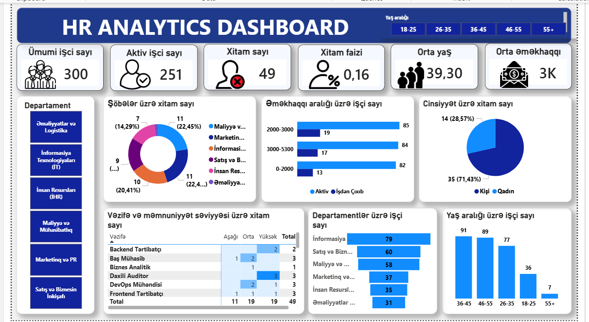

# HR-Analytics-PowerBI-Dashboard
Power BI ilə hazırlanmış HR Analitika və Kadr Axını (Turnover) Dashboard layihəsi.
# 📊 HR Analytics Dashboard - Power BI

Bu layihə şirkətin İnsan Resursları (HR) məlumatlarını təhlil etmək, kadr axınını (turnover) izləmək və demoqrafik göstəriciləri qiymətləndirmək üçün hazırlanmış interaktiv Power BI dashboard-udur.

---

## 🖼️ Dashboard Görünüşü

---

## 📈 Əsas KPI Göstəriciləri

* **Ümumi İşçi Sayı:** 300
* **Aktiv İşçi Sayı:** 251
* **Xitam Sayı:** 49
* **Xitam Faizi:** 16%
* **Orta Yaş:** 39.3
* **Orta Əməkhaqqı:** 3K AZN

---

## 🔍 Əsas Analitik Nəticələr (Insights)

1. **Kadr Axınının Səbəb Zonaları:** Xitam alanların **45%-ə yaxını** yalnız 2 sahənin payına düşür: *Maliyyə və Mühasibatlıq* (%22.45) və *Satış/Biznesin İnkişafı* (%22.45).
2. **Gender Bölgüsü (Xitam üzrə):** İşdən çıxan əməkdaşların **71.4%-i kişilərdir**.
3. **Yaş Paylanması:** Əsas işçi qüvvəsi **36–55 yaş** aralığındadır (180 nəfər).
4. **Maaş Diapazonları:** Ən sıx işçi qrupu **2000–3000 AZN** və **3000–5300 AZN** əməkhaqqı aralıqlarında cəmləşib.

---

## 🛠️ İstifadə Olunan Texnologiyalar

* **Power BI Desktop:** Vizualizasiya, Dashboard dizaynı və UI/UX tənzimləmələri.
* **DAX:** Hesablanmış ölçülər (Measures) və xüsusi KPI-lar üçün.
* **Power Query:** Məlumatların təmizlənməsi və transformasiyası (ETL).
* **Data Modeling:** Semantik model və cədvəllərarası əlaqələrin qurulması.
